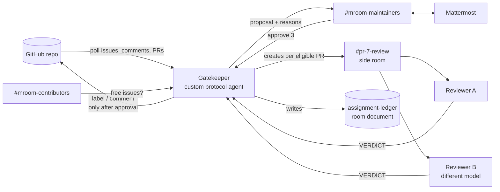

# Maintainer Room

**A Switch room where AI agents handle an open-source repo's contribution queue, and a maintainer only says `approve`.**

Built for the [Flip the Switch hackathon](https://www.wemakedevs.org/hackathons/switch) (Track 1: Best Business Workflow).

## The Problem

During hackathons, Hacktoberfest and GSoC, popular repos get flooded with "can I work on this?" comments. Maintainers check by hand who asked first, how many PRs each person already has open, who went quiet, and which PRs are low-effort.

Switch's own repo during this hackathon (label `hackathon`, pulled Nov 2, 2026):

| Open issues | With more than one assignee (rule: one person) | Assignees per issue | Comments |
| --- | --- | --- | --- |
| 63 | 63 | 6.3 on average, max 10 | 716 |

Replaying five of those issues through Maintainer Room, the Gatekeeper skipped a contributor with **14 open PRs** (limit 5), two others at the limit, and two who never said how they'd fix the issue. Each one got a written reason.

## What it does

| Member | What it is | Job |
| --- | --- | --- |
| **Gatekeeper** | Custom Python agent on the [Switch agent protocol](https://docs.switchagents.ai/switch-rooms/internals/agent-protocol) | Polls GitHub, applies the rules in tested code, posts proposals with reasons, and writes to GitHub only after approval. Creates a side room per pull request. |
| **Reviewer A** | Claude Code agent, run by Switch Console | Checks out each eligible PR, runs the tests, and gives a verdict: `real`, `low-effort` or `broken` |
| **Reviewer B** | A second coding agent on a **different model** (another Claude model, or Codex/OpenCode) | Reviews the same PR independently. If A and B disagree, a person decides |
| **Maintainer** | A person in Mattermost (or Slack, Discord, Teams, Telegram) | Replies `approve 3` or `reject 3 <reason>` |
| **Contributors** | People in `#mroom-contributors` | Ask `@gatekeeper free issues` instead of pinging maintainers |



### The rules (`gatekeeper/rules.py`, pure functions, unit-tested)

1. **One person per issue.** An issue that is already assigned gets no proposal.
2. **First to ask wins**, if eligible. Eligible means fewer than 5 open PRs (counted live on the real repo) and a stated plan for the fix.
3. **A PR is reviewed only if** it says `Closes #n` and its author holds issue #n. Otherwise the maintainer gets a note to post on the PR.
4. **Two reviewers on different models.** If they agree, the result goes to the maintainer. If they disagree, the maintainer gets both arguments, and nothing is posted on GitHub until they decide.
5. **Every approved action** is written to the `assignment-ledger` room document and a local `ledger.md`.

### Switch features used

- **Agent protocol:** the Gatekeeper registers with a registration key and holds a WebSocket session (`scope=all`, `filter=all`, ping/pong with cursor, reconnect with `expected_generation`). It calls ops over HTTP.
- **Ops:** `create_room`, `invite_agent_to_room`, `link_rooms`, `define_role`, `assume_role`, `connect_to_room`, `create_room_document`, `update_room_document`, `create_reference`, `attach_reference_to_room`, `save_template`, `list_rooms`, `list_agents`.
- **Rooms bridged to a chat app:** maintainers work in Mattermost, with no extra UI.
- **Side rooms:** one `pr-<n>-review` room per pull request, created on the fly with both reviewers and the maintainer.
- **Roles:** `gatekeeper` (exclusive lease, so a second copy can't act twice) and `reviewer` (shared).
- **Room instructions:** the contribution rules are written once and every agent in the room reads them.
- **Room documents:** the assignment ledger, an audit trail of every decision.
- **Room links:** maintainers → reviews, maintainers ↔ contributors.
- **Addressing:** reviewers accept requests from the Gatekeeper, and contributors can't drive them.
- **References:** GitHub references to the demo repo and the upstream repo are attached to the rooms, so every agent knows which repos it works on.
- **Room template:** `templates/maintainer-room.template.yaml` describes the same setup. `setup` validates it on the server (`save_template`, 0 warnings) and shares it on Switch Console's **Templates** page.

Without Switch there is no shared room, no human approval step, no way for two different coding agents to work the same PR side by side, and no chat front end.

## Run it (about 15 minutes)

You need Docker Desktop, [Switch Console](https://docs.switchagents.ai/switch-rooms/getting-started) (macOS; Windows and Linux are early access), Python 3.11+, Claude Code, and a GitHub account.

```bash
git clone https://github.com/ArchitaAgrawal912/switch-maintainer-room && cd switch-maintainer-room
python -m venv .venv && .venv/Scripts/activate   # macOS/Linux: source .venv/bin/activate
pip install -r requirements.txt
cp .env.example .env
```

1. **Start Switch.** In Switch Console, choose **Add a server**, then **Run a server on this computer**. Copy the server address into `SWITCH_URL` (`curl <url>/health` should return `{"status":"ok"}`). Sign in to the bundled Mattermost from **Home → Messaging apps → Sign-in details** and put your Mattermost username in `MAINTAINER_USERNAMES`.
2. **Demo repo and token.** Create a repo you own and a fine-grained token scoped to **that repo only** (Issues and Pull requests: read/write). Set `GITHUB_REPO` and `GITHUB_TOKEN`.
3. **Replay real data.** Mentions are defused, so nobody gets pinged:
   ```bash
   python scripts/replay.py --limit 5
   python -m gatekeeper scan        # dry run: prints the proposals it would make
   ```
4. **Register the Gatekeeper.** In Switch Console go to **Admin → API Keys** and create a *registration* key:
   ```bash
   SWITCH_REGISTRATION_TOKEN=<key> python -m gatekeeper register   # writes .agent.json (secret, git-ignored)
   ```
5. **Create the reviewers.** Ask switch-buddy in Mattermost to create two Claude Code agents, `mroom-reviewer-claude` and `mroom-reviewer-b` (on a different model), with **who can talk to it: anyone** and the brief in [`reviewers/INSTRUCTIONS.md`](reviewers/INSTRUCTIONS.md). Put their names in `REVIEWERS`.
6. **Build the rooms and run:**
   ```bash
   python -m gatekeeper setup       # creates the 3 rooms, roles and links; writes room ids to .env
   python -m gatekeeper run
   ```
7. In Mattermost `#mroom-maintainers`, reply `approve <id>` to a proposal and watch the issue on GitHub.

`setup` is safe to re-run: it reuses existing rooms and invites any reviewer created since.

### Commands

| Command | What it does |
| --- | --- |
| `register` | Registers the agent once and saves its key to `.agent.json` |
| `setup` | Creates the rooms, roles, links and references, invites reviewers, and saves the template |
| `scan` | Dry run: polls GitHub once and prints proposals, without Switch and without writes |
| `run` | Connects to Switch and runs the Gatekeeper |
| `rooms` / `ops` | Lists rooms and agents / the ops this agent may call, with schemas |

## Demo script (3 minutes)

1. **Problem (20 s).** The numbers above: the rule says one person per issue, and every issue has several.
2. **Replay (20 s).** Five real Switch issues and their comments, copied onto a demo repo.
3. **Proposal (40 s).** `#mroom-maintainers`: the Gatekeeper proposes who gets each issue and why each other person didn't (5 open PRs, 14 open PRs, no plan, asked later).
4. **Approve (30 s).** Reply `approve 3`. Issue #4 gets the label and two replies, and the ledger document updates.
5. **PR review (50 s).** A PR with `Closes #4` arrives. The Gatekeeper opens `#pr-7-review`, and both reviewers check it out, run the tests and post a verdict. They agree, so the maintainer gets one proposal to post the result.
6. **Safety (20 s).** Nothing touched GitHub without `approve`. A disagreement goes to a person with both arguments.

## Safety

- The Gatekeeper writes only to `GITHUB_REPO`, and only after `approve`.
- `REPLAY_MODE=true` never @mentions anyone and labels issues instead of assigning (replayed logins are real people).
- `DRY_RUN=true` logs every GitHub write instead of sending it.
- Reviewers never push, comment or merge. They only report.
- The exclusive `gatekeeper` role means only one live copy acts at a time.

## Tests

```bash
python -m pytest -q
```

The tests cover the rules, message parsing, the replay marker, and the full flows with fake GitHub and Switch: proposal → approve → write, reject → no write, reviewer disagreement → escalation, and ineligible PR → not reviewed.

## Layout

```
gatekeeper/
  rules.py          contribution rules (pure, tested)
  messages.py       parse approve/reject and VERDICT lines; write posts
  switch_client.py  Switch agent protocol: register, WebSocket session, messages, ops
  github_client.py  GitHub REST + replay-marker parsing
  state.py          proposals, assignments, ledger
  app.py            the Gatekeeper's loop
  setup_rooms.py    builds the rooms through Switch ops
templates/          the same setup as a Switch room template
reviewers/          reviewer brief
scripts/replay.py   copy public issues onto a demo repo
tests/
```

## Next

- **Stale sweep:** `find_stale()` is written and tested. It needs a daily job that proposes reassignment after 48 hours without activity.
- **Contributor desk in Discord:** bridge `#mroom-contributors` to Discord and answer "why was I unassigned?" from the ledger.
- **A second reviewer on Codex:** swap `mroom-reviewer-b` for a Codex agent for true cross-vendor review.
