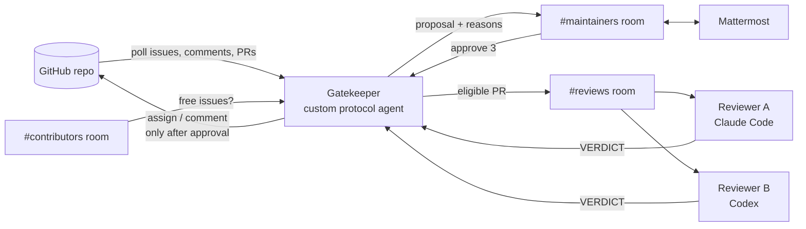

# Maintainer Room

**A Switch room where AI agents handle an open-source repo's contribution queue, and a maintainer only says `approve`.**

Built for the [Flip the Switch hackathon](https://www.wemakedevs.org/hackathons/switch) (Track 1: Best Business Workflow).

## The problem

During hackathons, Hacktoberfest and GSoC, popular repos get flooded with "can I work on this?" comments. Maintainers check by hand who asked first, how many PRs each person already has open, who went quiet, and which PRs are low-effort.

Switch's own repo during this hackathon (label `hackathon`, pulled Nov 2, 2026):

| Open issues | With more than one assignee (rule: one person) | Assignees per issue | Comments |
| --- | --- | --- | --- |
| 63 | 63 | 6.3 on average, max 10 | 716 |

## What it does

| Member | What it is | Job |
| --- | --- | --- |
| **Gatekeeper** | Custom Python agent on the [Switch agent protocol](https://docs.switchagents.ai/switch-rooms/internals/agent-protocol) | Polls GitHub, applies the rules in tested code, posts proposals with reasons, and writes to GitHub only after approval |
| **Reviewer A** | Claude Code, run by Switch Console | Checks out each eligible PR, runs the tests, and gives a verdict: `real`, `low-effort` or `broken` |
| **Reviewer B** | Codex, run by Switch Console | Reviews the same PR independently. If A and B disagree, a person decides |
| **Maintainer** | A person in Mattermost (or Slack, Discord, Teams) | Replies `approve 3` or `reject 3 <reason>` |

### The rules (`gatekeeper/rules.py`, pure functions, unit-tested)

1. **One person per issue.** An issue that is already assigned gets no proposal.
2. **First to ask wins**, if eligible. Eligible means fewer than 5 open PRs and a stated plan for the fix.
3. **A PR is reviewed only if** it says `Closes #n` and its author holds issue #n.
4. **Two reviewers.** If they agree, the result goes to the maintainer. If they disagree, the maintainer gets both arguments.
5. **Every approved action** is written to the assignment ledger: a Switch room document plus a local `ledger.md`.

### Switch features used

- **Agent protocol:** the Gatekeeper registers, holds a WebSocket connection (ping/pong, cursor, reconnect) and calls ops.
- **Rooms bridged to a chat app:** maintainers work in Mattermost, with no extra UI.
- **Room template:** `templates/maintainer-room.template.yaml` creates both reviewers, three linked rooms, roles, instructions and the ledger document.
- **Roles:** `gatekeeper` (exclusive, one holder) and `reviewer` (shared).
- **Instructions:** the contribution rules are written once and every agent in the room reads them.
- **Documents:** the assignment ledger, an audit trail of every decision.
- **Room links:** maintainers ↔ reviews ↔ contributors.
- **Addressing:** reviewers answer only their owner's agents and the owner, so contributors can't drive them.

Without Switch there is no shared room, no human approval step, no way for two different coding agents to work the same PR, and no chat front end.
