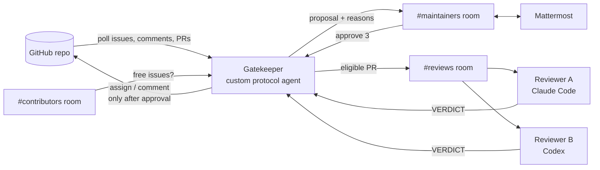

# Maintainer Room

**A Switch room where AI agents handle an open-source repo's contribution queue, and a maintainer only says `approve`.**

Built for the [Flip the Switch hackathon](https://www.wemakedevs.org/hackathons/switch) (Track 1: Best Business Workflow).

## The problem

During hackathons, Hacktoberfest and GSoC, popular repos get flooded with "can I work on this?" comments. Maintainers check by hand who asked first, how many PRs each person already has open, who went quiet, and which PRs are low-effort.

Switch's own repo during this hackathon (label `hackathon`, pulled Nov 2, 2026):

| Open issues | With more than one assignee (rule: one person) | Assignees per issue | Comments |
| --- | --- | --- | --- |
| 63 | 63 | 6.3 on average, max 10 | 716 |

## What it does

| Member | What it is | Job |
| --- | --- | --- |
| **Gatekeeper** | Custom Python agent on the [Switch agent protocol](https://docs.switchagents.ai/switch-rooms/internals/agent-protocol) | Polls GitHub, applies the rules in tested code, posts proposals with reasons, and writes to GitHub only after approval |
| **Reviewer A** | Claude Code, run by Switch Console | Checks out each eligible PR, runs the tests, and gives a verdict: `real`, `low-effort` or `broken` |
| **Reviewer B** | Codex, run by Switch Console | Reviews the same PR independently. If A and B disagree, a person decides |
| **Maintainer** | A person in Mattermost (or Slack, Discord, Teams) | Replies `approve 3` or `reject 3 <reason>` |



### The rules (`gatekeeper/rules.py`, pure functions, unit-tested)

1. **One person per issue.** An issue that is already assigned gets no proposal.
2. **First to ask wins**, if eligible. Eligible means fewer than 5 open PRs and a stated plan for the fix.
3. **A PR is reviewed only if** it says `Closes #n` and its author holds issue #n.
4. **Two reviewers.** If they agree, the result goes to the maintainer. If they disagree, the maintainer gets both arguments.
5. **Every approved action** is written to the assignment ledger: a Switch room document plus a local `ledger.md`.

### Switch features used

- **Agent protocol:** the Gatekeeper registers, holds a WebSocket connection (ping/pong, cursor, reconnect) and calls ops.
- **Rooms bridged to a chat app:** maintainers work in Mattermost, with no extra UI.
- **Room template:** `templates/maintainer-room.template.yaml` creates both reviewers, three linked rooms, roles, instructions and the ledger document.
- **Roles:** `gatekeeper` (exclusive, one holder) and `reviewer` (shared).
- **Instructions:** the contribution rules are written once and every agent in the room reads them.
- **Documents:** the assignment ledger, an audit trail of every decision.
- **Room links:** maintainers ↔ reviews ↔ contributors.
- **Addressing:** reviewers answer only their owner's agents and the owner, so contributors can't drive them.

Without Switch there is no shared room, no human approval step, no way for two different coding agents to work the same PR, and no chat front end.

## Run it (about 15 minutes)

You need Docker Desktop, [Switch Console](https://docs.switchagents.ai/switch-rooms/getting-started), Python 3.11+, Claude Code (and optionally Codex), and a GitHub account.

```bash
git clone <this repo> && cd maintainer-room
python -m venv .venv && .venv/Scripts/activate   # macOS/Linux: source .venv/bin/activate
pip install -r requirements.txt
cp .env.example .env
```

1. **Start Switch.** In Switch Console, choose **Add a server**, then **Run a server on this computer**. Sign in to the bundled Mattermost (Home → Messaging apps → Sign-in details) and link your account.
2. **Create a demo repo** on GitHub that you own, and a fine-grained token scoped to **that repo only** with Issues and Pull requests set to read/write. Put both in `.env` (`GITHUB_REPO`, `GITHUB_TOKEN`).
3. **Replay real data** onto it. Mentions are defused, so nobody gets pinged:
   ```bash
   python scripts/replay.py --limit 5
   python -m gatekeeper scan        # dry run: prints the proposals it would make
   ```
4. **Register the Gatekeeper.** In the Gateway, go to **API Keys** and create a *registration* key, then put it in `SWITCH_REGISTRATION_TOKEN`:
   ```bash
   python -m gatekeeper register    # writes .agent.json (secret, git-ignored)
   python -m gatekeeper ops         # the operations it may call, with argument schemas
   ```
5. **Create the rooms.** In Switch Console, go to **Templates → Import template**, choose `templates/maintainer-room.template.yaml`, then **Use** it. Pick `gatekeeper` in the Gatekeeper field.
6. **Fill in the room ids** (`python -m gatekeeper rooms` lists them) and reviewer names in `.env`, then run:
   ```bash
   python -m gatekeeper run
   ```
7. In Mattermost `#mroom-maintainers`, reply `approve 1` to the first proposal and watch the issue on GitHub.

## Demo script (3 minutes)

1. Show the numbers above. The rule says one person per issue; every issue has several.
2. `python scripts/replay.py`: real Switch issues and comments copied onto a demo repo.
3. The Gatekeeper posts a proposal in Mattermost: who gets the issue, and why each other person didn't.
4. Reply `approve 1`. The issue gets its label and a reply, and the ledger updates.
5. Open a PR on the demo repo with `Closes #<n>` (add `<!-- replay author=<winner> at=2026-11-07T00:00:00Z -->` to the body so it's credited to the winner). Both reviewers run the tests in `#mroom-reviews` and reply with a verdict.
6. Reviewers disagree, so the maintainer gets both arguments. Nothing is posted on GitHub until a person decides.

## Safety

- The Gatekeeper writes only to `GITHUB_REPO`, and only after `approve`.
- `REPLAY_MODE=true` never @mentions anyone and labels issues instead of assigning (replayed logins are real people).
- `DRY_RUN=true` logs every GitHub write instead of sending it.
- Reviewers never push, comment or merge. They only report.

## Tests

```bash
python -m pytest -q
```

The tests cover the rules, message parsing, the replay marker, and the full flows with fake GitHub and Switch: proposal → approve → write, reject → no write, reviewer disagreement → escalation, and ineligible PR → not reviewed.

## Layout

```
gatekeeper/
  rules.py          contribution rules (pure, tested)
  messages.py       parse approve/reject and VERDICT lines; write posts
  switch_client.py  Switch agent protocol: register, WebSocket, messages, ops
  github_client.py  GitHub REST + replay-marker parsing
  state.py          proposals, assignments, ledger
  app.py            the Gatekeeper's loop
templates/          Switch room template
reviewers/          reviewer brief (also inlined in the template)
scripts/replay.py   copy public issues onto a demo repo
tests/
```

## Next

- **Stale sweep:** `find_stale()` is written and tested. It needs a daily job that proposes reassignment after 48 hours without activity.
- **Contributor desk in Discord:** connect `#mroom-contributors` to Discord and answer "why was I unassigned?" from the ledger.
- **A side room per PR:** set `SIDE_ROOMS=true` once room creation through ops is confirmed on your server version.
